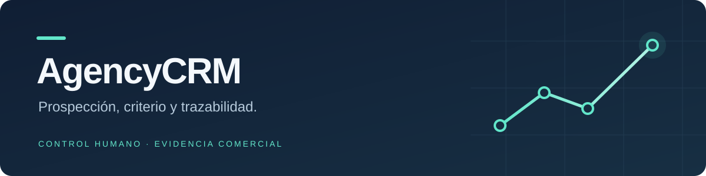
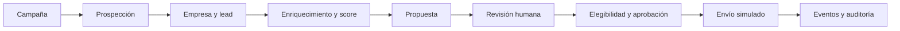

# AgencyCRM

CRM interno para agencias de marketing: organiza la captación B2B, convierte
datos comerciales en oportunidades explicables y prepara propuestas y contacto
con aprobación humana. Cada operación pertenece a un workspace y deja evidencia.

**Python 3.14 · Django 6.1 · DRF 3.18 · SQLite · Bootstrap 5 · MIT**

[Inicio rápido](docs/GETTING_STARTED.md) · [Documentación](docs/README.md) ·
[Contribuir](CONTRIBUTING.md) · [Historial](CHANGELOG.md)

## Qué ofrece

| Área | Capacidades |
|---|---|
| Captación | Campañas por sector y zona, planes de búsqueda, importación CSV y deduplicación |
| CRM | Empresas, contactos, leads, estados comerciales, oportunidades y tareas |
| Criterio comercial | Scoring reproducible con desglose, reglas y versiones |
| Propuestas | Generación determinista, revisión, aprobación y PDF privado |
| Contacto | Outbox, elegibilidad, supresión, límites, aprobación y envío simulado |
| Operación | Dashboard por workspace, cola persistida, auditoría, exportación y backup |
| Integración | API interna con sesión y CSRF; adapters externos opcionales |

El flujo mock funciona sin credenciales externas, Docker, Redis ni servicios de IA.
Bootstrap se sirve desde el repositorio, sin CDN. Los adapters de Google Places,
crawler, SMTP y WhatsApp Cloud cuentan con pruebas mediante fixtures y mocks;
los ensayos con credenciales reales siguen pendientes. Consulta los límites en
[Providers](docs/PROVIDERS.md) y la evidencia en [Aceptación](docs/ACCEPTANCE.md).

## Empezar en local

Necesitas Python **3.14** y Git. Desde una copia del repositorio, en PowerShell:

```powershell
py -3.14 -m venv .venv
.\.venv\Scripts\Activate.ps1
python -m pip install -r requirements.lock
Copy-Item .env.example .env
python -c "import secrets; print(secrets.token_urlsafe(50))"
```

Copia la clave generada al campo `SECRET_KEY` de `.env`. La copia de `.env.example`
es solo para una instalación nueva: conserva tu configuración si ya existe `.env`.

```powershell
python manage.py migrate
python manage.py seed_demo --create-user demo
python manage.py changepassword demo
python manage.py runserver 127.0.0.1:8000
```

Abre **http://127.0.0.1:8000/** y entra con `demo` y la contraseña que has elegido.
Los datos son ficticios; el seed no envía mensajes ni activa providers reales.
En un segundo terminal, activa el mismo entorno y ejecuta:

```powershell
python manage.py run_worker
```

SQLite admite **un solo worker por base de datos**. La guía de
[inicio](docs/GETTING_STARTED.md) cubre Linux/macOS, cuentas de administración,
configuración y problemas habituales. El servidor de desarrollo es para uso local.

## Flujo comercial



El dashboard muestra estados actuales: empresas totales, leads no archivados por
estado, jobs fallidos y mensajes pendientes de aprobación. No son conversiones
acumuladas; las cifras se recalculan al consultar la página.

## Arquitectura y garantías

Las views presentan y validan el transporte; los selectors consultan datos y los
services ejecutan mutaciones. Policies y providers tienen responsabilidades
separadas. UUID, constraints, transacciones e idempotencia protegen el dominio.

Sesión y CSRF están activos. La aplicación exige usuario, workspace y membership
activos, también a superusuarios. Los documentos comerciales se descargan con
autorización; los secretos viven en el entorno. SQLite no tiene RLS: el acceso
directo al fichero y al ORM es una interfaz de confianza del operador.

La infraestructura inicial es SQLite y filesystem local, con settings `base`,
`local` y `test`. PostgreSQL y otro dispatcher son evoluciones previstas que
requerirán validación propia. No existe todavía una configuración de producción.

```text
apps/          Dominio, services, selectors, UI y API por módulo
common/        Scoping, transporte, seguridad y utilidades compartidas
config/        Settings, rutas y puntos de entrada Django
integrations/  Contratos, mocks y adapters externos
templates/     Interfaz Django
static/        Estilos y Bootstrap local
tests/         Pruebas unitarias, integración y aceptación offline
docs/          Guías y referencia del sistema
```

## Calidad

La [verificación funcional](docs/FUNCTIONAL_VERIFICATION.md) reúne la matriz de
integración y los escenarios de instalación limpia, formularios y API comprobados.

Con el entorno virtual activo:

```powershell
python manage.py check
python manage.py makemigrations --check --dry-run
python -m pytest
python -m ruff check .
python -m coverage run -m pytest
python -m coverage report
```

Las pruebas usan settings aislados y bloquean la red. La cobertura mínima global
configurada es **80 %**. Los resultados de cada entrega se registran en el
[changelog](CHANGELOG.md); la guía de [desarrollo](docs/DEVELOPMENT.md) explica
los checks y la gestión de dependencias.

## Documentación, contribuciones y licencia

El [índice](docs/README.md) reúne instalación, arquitectura, dominio, API,
seguridad y operación. El [playbook](IMPLEMENTATION_PLAYBOOK_AGENCYCRM.md)
conserva la especificación y fases originales; las guías actuales documentan
el comportamiento implementado. Las notas anteriores están en el
[archivo de implementación](docs/history/IMPLEMENTATION_NOTES.md).

Antes de proponer cambios, lee [CONTRIBUTING](CONTRIBUTING.md). Para reportar
vulnerabilidades consulta [SECURITY](SECURITY.md). La preparación de un remoto
y de una publicación se describe en [Publicación](docs/PUBLISHING.md).

El código propio se distribuye bajo [MIT](LICENSE). Bootstrap conserva su
licencia y atribución originales; consulta [avisos de terceros](THIRD_PARTY_NOTICES.md).
