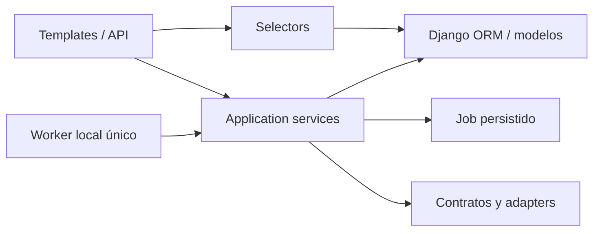

# Arquitectura actual de AgencyCRM V1

Aplicación Django local con Python 3.14, Django 6.1.x, DRF 3.18.x, SQLite,
templates y Bootstrap local. No necesita Docker, Redis ni servicios externos
para operar el flujo mock. El servidor HTTP y el worker se ejecutan por separado.

## Límites entre capas

- Views, formularios y serializers validan el transporte y presentan resultados.
- Selectors consultan datos dentro del workspace autorizado; no generan trabajo.
- Services autorizan otra vez y aplican mutaciones, transiciones y auditoría.
- Policies/engines calculan reglas sobre datos normalizados, sin llamadas remotas.
- Providers devuelven resultados/errores normalizados; no escriben dominio.
- Los modelos validan relaciones, valores, identidad tenant y constraints; no
  llaman APIs. No hay signals propias para operaciones de aplicación.

El ORM es la capa de persistencia: no se añade una abstracción de repositorios
paralela. `common/services.py` admite campos explícitos y revalida relaciones;
sus creaciones usan INSERT para no sobrescribir un UUID existente. Los services
especializados controlan versiones, compare-and-swap, hashes e idempotencia.

## Mapa de módulos

| Módulo | Responsabilidad |
|---|---|
| `accounts` | User UUID, workspaces, memberships, agencia/servicios, login y seed demo |
| `companies`, `campaigns`, `crm` | Datos normalizados, campañas, leads, pipeline e historial |
| `prospecting` | Planes acotados, CSV, adquisición, provenance y dedupe conservador |
| `scoring` | Reglas declarativas, snapshots, breakdown, oportunidades y lotes |
| `proposals` | Versiones deterministas, revisión/aprobación y archivos PDF privados |
| `outreach`, `compliance` | Preparación, política, aprobación, envío, tareas y supresión |
| `jobs` | Cola ORM, intentos, recovery, handlers y bloqueo OS por base de datos |
| `audit` | Eventos append-only, consulta filtrada y exportación/retención operativas |
| `dashboard` | Agregados vivos por workspace e instantáneas mediante Jobs |
| `integrations` | Contratos, mocks, Google Places, crawler, SMTP y WhatsApp Cloud |
| `common` | Transporte, scoping, helpers, uploads, paths privados, backups y normalización |

La API vive en `api/` de cada app y comparte transporte en `common/api.py`.
El contrato de endpoints, JSON, filtros, sesión y CSRF está en [API.md](API.md).

## Workspace y autenticación

Una sesión identifica al User; cada operación selecciona además un workspace.
Los selectors/services exigen usuario activo, workspace activo y membership
activa. La API exige `workspace_id` explícito; las rutas UI lo llevan en el path.
Las relaciones se resuelven dentro de ese mismo espacio y los UUID ajenos
devuelven 404. Ser superusuario no evita este control en la aplicación.

El admin de plataforma es global y reservado a superusuarios: configura cuentas,
workspaces, memberships, agencia y servicios. Los modelos comerciales son readonly
en ese admin. Backup/restore son herramientas del operador local y abarcan toda
la instalación; no se exponen como permisos de un workspace ni por HTTP.

Los filtros ORM arbitrarios, bulk/raw SQL y el acceso directo al fichero DB son
interfaces de confianza; SQLite no proporciona RLS. Las barreras del dominio son
los servicios/selectors y la validación/constraints, no el secreto de los UUIDs.
La matriz de permisos y el checklist se encuentran en [SECURITY.md](SECURITY.md).

## Jobs y recuperación

Las views encolan trabajo; no crean procesos/hilos ni ejecutan el worker.
`JobRunner` reclama un Job con token e intento, ejecuta fuera de la transacción de
claim y confirma resultado/intento/auditoría. Los handlers protegen los commits
contra contextos antiguos y revalidan el actor y el workspace. Un único WorkerLock
OS se comparte con recuperación, seed y backup sobre la misma base SQLite.

Los errores de proveedor se normalizan y solo los temporales admiten retries
acotados. Una aceptación incierta de SMTP/WhatsApp bloquea el replay y exige
reconciliación; no se interpreta un timeout como prueba de que no hubo envío.

Los handlers actuales incluyen búsqueda, enriquecimiento, scoring, propuesta,
contacto, retención, lotes de scoring, métricas y diagnóstico mock. Los enums
BUILD_SEARCH_PLAN/PREPARE_OUTREACH no tienen handlers: planificación/preparación
acotadas se hacen mediante sus services, y sus payloads como Jobs se rechazan.
El lote REBUILD_SCORES congela los IDs de sus hijos en auditoría; métricas conserva
su medición original. Sus detalles están en [OPERATIONS.md](OPERATIONS.md).

## Archivos y seguridad operativa

Los documentos se almacenan bajo rutas UUID de `MEDIA_ROOT`, sin ruta pública
de media. Descargas privadas comprueban workspace, formato, tamaño y hash.
Uploads PDF y paths rechazan contenido activo y symlinks/junctions; las respuestas
usan sandbox y no-store. Logo de agencia es un campo reservado, sin uploader
implementado: no se declara como funcionalidad disponible.

CSP usa el middleware nativo de Django y recursos locales. Sesiones y POST
conservan CSRF; settings de HTTPS son una plantilla futura y necesitan operador.
Secrets viven en entorno. Auditoría/logs contienen IDs/códigos/contadores curados;
la redacción por claves no pretende detectar secretos arbitrarios en texto libre.

## Sustitución futura de infraestructura

El dominio consulta ORM portable y usa datetimes conscientes de zona horaria.
El cliente HTTP y los provider contracts no dependen de SQLite. Migrar a PostgreSQL
requiere settings, verificación de concurrencia/índices y un adaptador de backup
distinto; `common/backups.py` es explícitamente un adaptador offline de SQLite.

Celery sustituiría claim/dispatch/bloqueo del worker conservando casos de uso,
idempotencia, autorización y políticas. Object storage sustituiría almacenamiento
y entrega de documentos privados. Estas sustituciones no están implementadas.

La evidencia del flujo funcional offline está en [ACCEPTANCE.md](ACCEPTANCE.md).
